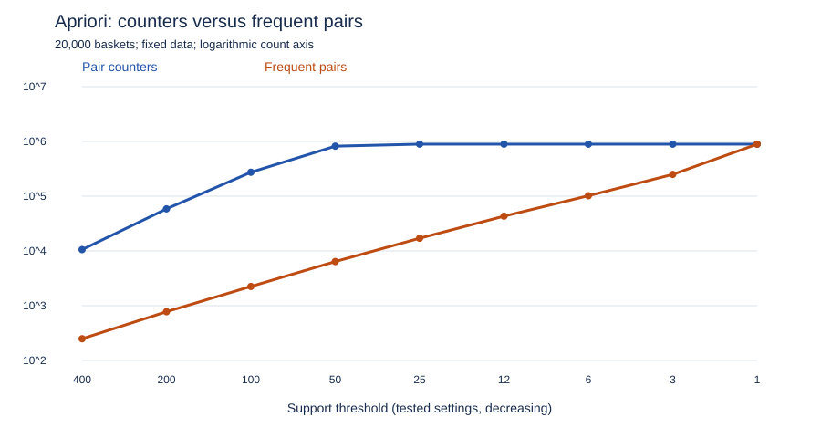

# Task 2 — 지지도와 후보 계수 비용

## 예상과 조건

지지도를 낮추면 첫 통과에서 더 많은 항목이 살아남아 후보가 빠르게 늘 것으로 예상했다. 다만 고정된 유한 데이터에서는 후보 수에 상한이 있으며, 실제 정답 수와 후보 수가 같은 속도로 증가할 필요는 없다.

CPU 11th Gen Intel(R) Core(TM) i5-11400H @ 2.70GHz, RAM 15.74 GiB, Windows-10-10.0.26200-SP0, Python 3.11.9에서 실행했다. Codex가 실행 중이고 다른 사용자 앱은 통제하지 않았다. 고정 시드 246의 동일한 20,000개 장바구니·2,000개 상품 데이터를 사용했다. 제공 PlainApriori와 bench.py는 변경하지 않았다.

지지도당 한 번씩 측정했다. 알고리즘 호출에 tracemalloc 계측 비용이 포함된다. 입력 생성·사전 환경 조사·파일 저장은 시간에서 제외되며, 메모리는 이미 생성한 입력을 제외한 Python 추가 할당 최고값으로 전체 프로세스 RAM이 아니다. 결과 사전 생성 비용은 포함된다. 이전 결과는 다음 조건 전에 해제했다. 400은 첫 실행, 나머지는 후속 실행 묶음이다. 각 행에 환경 기록을 보존했다.

## 측정 표 (A1, A3)

| 지지도 | 빈발 항목 | 최대 쌍 카운터 | 빈발 쌍 | 직전 대비 카운터 배율 | 직전 대비 정답 배율 | 시간(s) | 메모리(MB) |
|---:|---:|---:|---:|---:|---:|---:|---:|
| 400 | 146 | 10,585 | 249 | — | — | 3.34 | 1.06 |
| 200 | 345 | 58,626 | 776 | 5.539 | 3.116 | 7.86 | 6.50 |
| 100 | 825 | 273,701 | 2,244 | 4.669 | 2.892 | 12.71 | 26.53 |
| 50 | 1,849 | 820,259 | 6,397 | 2.997 | 2.851 | 13.83 | 102.43 |
| 25 | 2,000 | 893,456 | 17,045 | 1.089 | 2.665 | 11.57 | 102.17 |
| 12 | 2,000 | 893,456 | 43,116 | 1.000 | 2.530 | 13.50 | 102.72 |
| 6 | 2,000 | 893,456 | 101,938 | 1.000 | 2.364 | 20.24 | 119.36 |
| 3 | 2,000 | 893,456 | 250,054 | 1.000 | 2.453 | 25.33 | 156.59 |
| 1 | 2,000 | 893,456 | 893,456 | 1.000 | 3.573 | 18.54 | 327.02 |

MB는 1,000,000 bytes이다. 9개 지지도, 최대·최소 400배 범위이다. 25→12, 3→1은 정확히 절반은 아니며 배율은 실제 이웃 측정값으로 계산했다. 시간은 단회 관찰이므로 작은 차이의 의미를 과장하지 않는다.



세로축은 로그 눈금이며 가로축은 측정 조건 순서다. 두 곡선의 원자료는 위 표와 같다.

## 증가 양상과 정답 수의 차이 (A4, A5)

지지도 400→200→100→50에서 카운터는 약 5.54·4.67·3.00배 늘었다. 지지도를 절반으로 낮추면 두 배 정도만 늘 것이라는 단순한 예상보다 빠르다. 반면 50→25에서는 증가폭이 작아졌다. 지지도 25부터 모든 2,000개 항목이 첫 통과를 통과했다. 이후 같은 입력의 실제 공출현 쌍을 모두 세기 때문에 지지도를 더 낮춰도 새 후보 카운터가 계속 늘지는 않는다. 전체 가능한 쌍 1,999,000개를 모두 미리 할당한 것도 아니다.

빈발 쌍은 이미 세고 있던 후보 중 최종 기준을 통과한 것이다. 낮은 지지도 구간에서는 후보 카운터가 포화되어도 정답 수는 계속 증가한다. 따라서 카운터가 항상 정답보다 더 빠르게 증가한다거나 정답 수가 늘 느리게 증가한다고 일반화할 수 없다. 지지도 50에서는 820,259개 카운터로 6,397개 정답을 찾아 약 128배의 차이가 있었지만, 지지도 1에서는 관찰된 모든 쌍이 답이 되어 두 수가 같아진다.

카운터가 일정해도 반환 결과 사전이 커지면 Python 메모리는 늘 수 있다. 따라서 쌍 카운터 수와 전체 추가 할당의 최고값도 서로 다른 지표다.


## 종료 지점과 한계 (A2)

최소 양의 지지도 1까지 완료했고, 설정한 시간·메모리 기준에는 도달하지 않았다. 가장 긴 실행은 25.33초, 가장 큰 추가 할당은 327.02 MB였다. 시간 60초 또는 추가 할당 1 GB를 완료 조건별 확장 중지 기준으로 설정했으며 메모리 부족·실행 실패는 관찰되지 않았다. 이 기준은 강제 timeout이나 메모리 제한은 아니다.

이번 고정 데이터에서 컴퓨터가 감당하지 못하는 지지도를 발견했다고 주장하지 않는다. 과제 A2가 기대하는 실제 부담 지점은 관찰하지 못했으며, 지원 범위의 최솟값에 도달한 결과로 기록한다. 입력 크기를 바꾸면 다른 결과가 나올 수 있지만 이번 실험에서 측정한 것은 아니다.

## 재현

```bash
python task2_explosion.py --supports 400,200,100,50,25,12,6,3,1
python task2_report.py
python test_tasks.py --task 2
```

측정값은 [explosion.json](explosion.json)에 조건 완료마다 저장·누적된다. 보고서 생성기는 같은 지지도의 마지막 완료 행을 선택한다.
